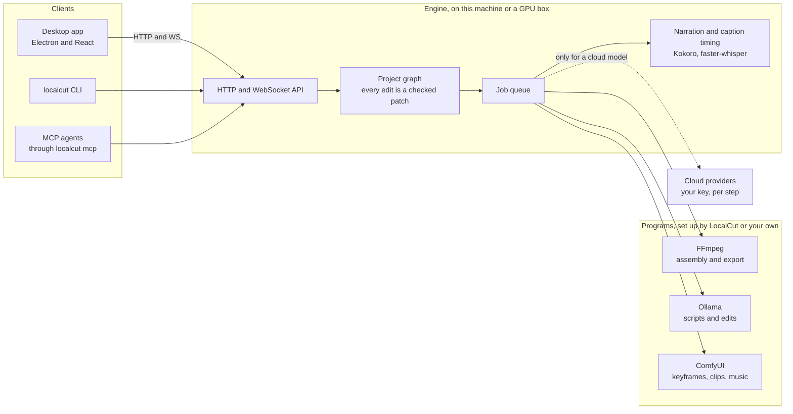

<div align="center">


# LocalCut AI

**Prompt in, finished video out, on your own GPU.**

One prompt becomes a script, keyframes, clips, narration, music and captions, all made on your machine and cut into one video.<br>
No account, no subscription. Your prompts and footage stay with you unless you pick a cloud model.

[](https://github.com/echem-labs/local-cut-ai/actions/workflows/ci-engine.yml)
[](https://github.com/echem-labs/local-cut-ai/actions/workflows/ci-desktop.yml)
[](LICENSE)
[](#requirements)

**[Download](#download)** ·
**[First run](#first-run)** ·
**[Documentation](#documentation)** ·
**[Run it on a GPU box](docs/remote-and-cloud.md)** ·
**[Contributing](#contributing)**

</div>

---

## What is LocalCut AI?

LocalCut AI is a desktop app that makes a short video from a prompt, or from a script you paste in. It writes the screenplay, draws a keyframe for each scene, animates it, narrates it, scores it, captions it word by word and cuts it all together into an MP4.

It aims for CapCut's ease of use with [ComfyUI](https://github.com/Comfy-Org/ComfyUI)'s power underneath. You type one line and get a finished cut, the way you would in CapCut. The pictures, clips and music come from open models that ComfyUI runs on your graphics card, so a video costs nothing per render and your footage never has to leave your computer. When the first cut isn't right, you can open the same project as a flowchart and change any step of it.

It is early. One prompt renders a watchable 60-second video, unattended, on an 8 GB laptop GPU. There is no release yet. Until 0.1.0 is out, you can build the app from source.

## Features

<table>
  <tr>
    <td width="50%" valign="top">
      <h3>Prompt to finished video</h3>
      Script, keyframes, clips, narration, music, word-timed captions and a thumbnail, exported as one MP4. <b>Auto</b> runs straight through. <b>Review steps</b> stops for you at the script and again at the storyboard.
      <br><a href="docs/running-real-models.md">Running with real models</a>
    </td>
    <td width="50%" valign="top">
      <h3>One project, three views</h3>
      Storyboard, Player and Flowchart are three views of one project, with the Inspector beside each to edit any step. Every edit goes through the same checks, whichever view it came from.
      <br><a href="docs/editing.md">Editing a project</a>
    </td>
  </tr>
  <tr>
    <td width="50%" valign="top">
      <h3>Models that fit your GPU</h3>
      The first run reads your hardware, recommends a model for every stage and downloads them inside the app. Drafts come back fast. <b>Create final video</b> then renders again at full quality, up to Wan 2.2 on a 16 GB card.
      <br><a href="docs/running-real-models.md#quality-ladder">The quality ladder</a>
    </td>
    <td width="50%" valign="top">
      <h3>Sets up what it runs on</h3>
      On Windows and Linux, one click downloads and starts LocalCut's own FFmpeg, Ollama and ComfyUI, with the ComfyUI build for your graphics card. Already have them? It finds yours and uses them.
      <br><a href="docs/programs.md">Programs</a>
    </td>
  </tr>
  <tr>
    <td width="50%" valign="top">
      <h3>Voices, with consent</h3>
      Fifty-four stock voices you can audition before you pick one. Cloning a real person's voice needs you to confirm you have their permission. For now it runs only in a build from source. A clone never falls back to someone else's voice.
      <br><a href="docs/voices.md">Narration voices</a>
    </td>
    <td width="50%" valign="top">
      <h3>Edit in plain words</h3>
      Ask for "make scene 2 darker" or "crossfade everything" and only what the edit touches renders again. Drop in your own image and a scene animates from it instead of a generated keyframe.
      <br><a href="docs/editing.md">Editing a project</a>
    </td>
  </tr>
  <tr>
    <td width="50%" valign="top">
      <h3>Hand off to your editor</h3>
      Export the timeline as OpenTimelineIO for DaVinci Resolve or Premiere, or as FCPXML for Final Cut Pro, at the same length as the rendered MP4. A publish kit adds a title, a description and hashtags.
      <br><a href="docs/running-real-models.md#handing-off-to-an-nle">Handing off to an NLE</a>
    </td>
    <td width="50%" valign="top">
      <h3>One-off tools</h3>
      Need only a script, an image, a clip, a voiceover, a music track or a thumbnail? Each has its own tool on the home screen with no project to set up. The result can become a video later.
    </td>
  </tr>
  <tr>
    <td width="50%" valign="top">
      <h3>A GPU box, driven from a laptop</h3>
      Run the engine headless on a machine with a big GPU and pair a laptop with it over pinned TLS. Close the laptop mid-render and the box keeps going.
      <br><a href="docs/remote-and-cloud.md">Remote engine and cloud</a>
    </td>
    <td width="50%" valign="top">
      <h3>Built for scripts and agents</h3>
      A <code>localcut</code> command line whose exit codes a script can branch on, plus an MCP server for agents. An agent can create, render, edit and export, but it can't spend your cloud keys.
      <br><a href="docs/agents-and-automation.md">Agents and automation</a>
    </td>
  </tr>
</table>

## Download

There is no release yet. When 0.1.0 is out, it will be on the [Releases page](https://github.com/echem-labs/local-cut-ai/releases) and a download button will go here. Pick the file for your system:

| System | File |
| --- | --- |
| Windows, x64 | `LocalCut AI Setup <version>.exe` |
| Linux, x64 | `LocalCut AI-<version>.AppImage`, or `localcut-desktop_<version>_amd64.deb` for Debian and Ubuntu |
| macOS, Apple silicon | `LocalCut AI-<version>-arm64.dmg` |

The installers aren't signed yet. Signing comes after the first release. Until then, Windows SmartScreen stops the installer the first time you run it: choose **More info**, then **Run anyway**. The Windows installer is per user and asks for no admin rights.

On Linux, make the AppImage executable (`chmod +x`) and run it, or install the `.deb` with `sudo apt install ./localcut-desktop_<version>_amd64.deb`. The AppImage doesn't need libfuse2.

The macOS build is a different story. It is unsigned and not notarized, so Gatekeeper will refuse it. Nothing installs in one click on a Mac either. Nobody has tried it by hand yet, so treat it as untested.

### Requirements

| | |
| --- | --- |
| Windows | Windows 10 version 1903 or later, or Windows 11, on x64 |
| Linux | Ubuntu 22.04 or later, or another x64 distribution with glibc 2.35 or newer |
| macOS | Apple silicon. Untested, see above |
| Graphics card | An NVIDIA card with 8 GB is the setup it is tested on. AMD and Intel cards get their own ComfyUI build, untested so far |
| Memory | 16 GB of RAM for the full set of recommended models |
| Disk | About 40 GB for a full local setup on an 8 GB NVIDIA card |

The Windows floor comes from narration. The engine declares UTF-8 as its ANSI code page, which Windows honours from version 1903. On an older build, every narration fails for someone whose profile folder name isn't plain ASCII.

The Linux floor comes from the build. The packaged engine carries a few libraries from the Ubuntu 22.04 system it is built on, which need glibc 2.35. The packaging workflow fails any build in which a file in the app or its engine needs a newer one. It also makes a short video with the engine on Ubuntu 22.04 before it builds the installers. The same engine serves on Ubuntu 24.04 and 26.04.

The 40 GB is measured from what LocalCut pins and recommends. Model weights for keyframes, clips, music, narration and captions take about 27 GB and the script model in Ollama about 5 GB. The three programs take 7 GB on Windows or 10 GB on Linux. A 16 GB card with 32 GB of RAM is offered Wan 2.2 and a larger script model, which come to about 28 GB more. A machine with no graphics card can still make a video. On Linux, ComfyUI has a build for the processor, where a keyframe takes minutes rather than seconds. Windows has no such build, so keyframes, clips and music come out as stand-ins there.

## First run

The first time it opens, LocalCut AI walks you through a short setup. It reads your graphics card, memory and free disk, then picks a model for each stage that fits them. It checks for FFmpeg, Ollama and ComfyUI and offers to set up whichever is missing. On Windows and Linux, **Set up all three** does it in one go. Next come the recommended models, already ticked. Untick any you don't want, or open the full library and swap one.

Setup and downloads keep going in the background while the last step shows where each has got to. You don't have to wait for them: stages fill in as their models arrive.

On the home screen, type a prompt and choose the aspect ratio, the length and **Auto** or **Review steps**. **Generate** (or Ctrl+Enter) starts it.

### What runs where

The app is two parts: the window you see and the engine it starts, which holds your projects and runs the work. Both come in the installer. Narration and caption timing run inside the engine, with weights the Models step downloads. The rest of the work happens in three free programs that LocalCut doesn't ship:

- FFmpeg puts the video together: cuts, music, captions, titles and the final MP4.
- Ollama writes the script and makes the changes you ask for in plain words. Any OpenAI-compatible server works in its place.
- ComfyUI draws the keyframes, animates the clips and makes the music.

| | FFmpeg | Ollama | ComfyUI |
| --- | --- | --- | --- |
| Windows x64 | one click | one click | one click: builds for NVIDIA, AMD and Intel |
| Linux x64 | one click | one click | one click: builds for NVIDIA, AMD, Intel and the processor |
| macOS, Linux on ARM | steps in the app | steps in the app | steps in the app |

One click downloads a pinned build and checks its size and SHA-256 before keeping it in `~/.localcut/programs`. It needs no admin rights and writes nothing outside `~/.localcut`. LocalCut then starts its Ollama and ComfyUI when the app opens and stops them when it closes. If you already run one of the three, LocalCut finds it and uses yours instead: an FFmpeg on your `PATH`, an Ollama at `127.0.0.1:11434`, a ComfyUI at `127.0.0.1:8188`. Settings > Programs shows what was found and where. [Programs](docs/programs.md) has the details, down to the file counts.

Until Ollama or ComfyUI is set up, the stages that need it come out as stand-ins, so a first render still runs end to end. FFmpeg is different. Without it there is no final video, so the render stops at that step instead of handing you a placeholder.

## Build from source

You need Python 3.13 or 3.14 with [uv](https://docs.astral.sh/uv/), Node ≥22.13 and git. A GPU, models and ComfyUI are optional.

```bash
git clone https://github.com/echem-labs/local-cut-ai.git
cd local-cut-ai/apps/desktop
npm install
npm run dev
```

The app starts its own engine through `uv`, on the backend chain `local,mock`. Each real backend claims only the work it can do right now and the mock backend stands in for the rest, apart from the final cut, which needs FFmpeg. So a machine with FFmpeg and nothing else renders the whole pipeline in placeholders. Every model you add replaces some of them. `LOCALCUT_ENGINE_CMD` and `LOCALCUT_BACKEND` change how the app launches it.

On Windows, run `npm run dev:shortcut` once per checkout. Without it a dev build's notifications come from "Electron", because Windows takes a notification's name and icon from a Start Menu shortcut that only the installer creates.

<details>
<summary><b>The engine on its own, on placeholders</b></summary>

<br>

Deterministic output whatever is installed, for working on the API:

```bash
cd engine
uv sync
uv run localcut serve --backend mock   # API on 127.0.0.1:7830
```

</details>

<details>
<summary><b>The engine on a GPU box</b></summary>

<br>

```bash
LOCALCUT_TOKEN="$(openssl rand -base64 32)" \
  LOCALCUT_ADVERTISE=gpu-box.local \
  docker compose -f deploy/docker-compose.yml up -d
```

The engine prints a pairing code. Paste it into the laptop's Settings and the app pins the box's certificate. [Remote engine and cloud](docs/remote-and-cloud.md) has the rest.

</details>

[Packaging](docs/packaging.md) covers freezing the engine and building the installers yourself.

## Scripts and agents

The `localcut` command drives a running engine, on this machine or a paired one. Every command needs the engine's token, so start the engine with one you chose:

```bash
cd engine
export LOCALCUT_TOKEN="$(openssl rand -hex 24)"
uv run localcut serve --backend local,mock   # leave it running: the API is on 127.0.0.1:7830
```

Then, in a second terminal in `engine/` with the same `LOCALCUT_TOKEN` exported:

```bash
uv run localcut create "how honeybees make honey"     # prints the new project's id
uv run localcut render <project-id>                   # renders it and waits
uv run localcut export <project-id> --out honeybees.mp4
```

Exit status is `0` when it worked, `1` when the operation failed and `2` when the engine could not be reached, so a script can branch without parsing output. `localcut mcp` serves the same engine to MCP hosts such as Claude and goose. [Agents and automation](docs/agents-and-automation.md) covers both.

## How it fits together



The desktop app never reads the engine's files. That is why an engine on another machine needs no special case.

## Privacy

- Neither the app nor the engine collects telemetry or crash reports. There is no account to make.
- Your prompts, scripts, pictures, sound and videos stay on the machine that runs the engine. With a paired GPU box that machine is the box. The laptop reaches it over a pinned TLS connection with a token.
- LocalCut AI goes online when you ask it to. That means downloading a model (from Hugging Face or GitHub), setting up a program (from each project's own releases, plus PyPI and PyTorch's package index for ComfyUI on Linux) or pulling the script model into Ollama from Ollama's registry.
- It looks for an update only when you press **Check for updates** in Settings > About. That asks GitHub for the latest release and downloads nothing.
- A cloud model needs a key you add in Settings > Providers, for Anthropic, OpenAI, Google or fal.ai. It runs only for the steps you pick it for. Only what those steps need goes to that provider. Keys stay on your computer and go only to your own engine, which uses them to call the provider.
- LocalCut's own Ollama runs with Ollama's cloud features off. An Ollama of your own keeps its own settings. A cloud model you pick in it runs on Ollama's servers.
- The app window checks spelling with the spellchecker built into Windows or macOS and never downloads a dictionary. Linux has none it can use, so spelling goes unchecked there.
- Cloning a voice needs you to confirm you have the speaker's permission.

Settings > About says the same.

## Documentation

| Guide | Covers |
| --- | --- |
| [Running with real models](docs/running-real-models.md) | Backends, ComfyUI, the quality ladder, timing and audio |
| [Narration voices](docs/voices.md) | Stock voices and consent-gated cloning |
| [Editing a project](docs/editing.md) | Natural-language edits, your own images, re-cuts |
| [Programs](docs/programs.md) | FFmpeg, the LLM server and ComfyUI: where the engine finds them and the copies it sets up itself |
| [Remote engine and cloud](docs/remote-and-cloud.md) | Headless on a GPU box, TLS pairing, BYOK providers |
| [Agents and automation](docs/agents-and-automation.md) | The automation CLI and the MCP server |
| [Packaging](docs/packaging.md) | Freezing the engine and building installers |

## Contributing

[CONTRIBUTING.md](CONTRIBUTING.md) covers how to submit a change and the sign-off it needs. [CLAUDE.md](CLAUDE.md) holds the conventions a test will fail you on. [AGENTS.md](AGENTS.md) points a coding agent at them.

Install the hooks once, from the repository root:

```bash
uv run --project engine pre-commit install
```

Commits get `ruff check --fix` and `ruff format`. Pushes also run the engine suite, the desktop typecheck and tests, the icon check and the contract tests that read a file from the other half of the tree. Each is gated on the files it reads, so a desktop-only push doesn't pay for the engine suite. `--no-verify` skips them.

```bash
cd engine
uv run pytest -q -rs                   # -rs lists what was skipped
cd ../apps/desktop
npm run typecheck && npm test
npm run icon:check                     # committed icons still match branding/logo.svg
```

Read the skip list. Without ffmpeg on `PATH`, the tests that assemble, burn in captions or read waveform peaks skip instead of failing. The suite then reads green having run none of them. Install ffmpeg, or point `LOCALCUT_FFMPEG_BIN` at one.

The push hook runs on whichever platform you are on. CI runs the engine suite on Linux, macOS and Windows and the desktop suite on Linux and Windows.

<details>
<summary><b>Repository layout</b></summary>

<br>

```text
engine/         Python orchestrator: project graph, compiler, job queue,
                execution backends, model manifest, FastAPI and WS API
apps/desktop/   Electron and React app, talks to the engine only over
                HTTP and WS, so a remote engine behaves the same
branding/       logo.svg, the source every app icon is generated from
deploy/         docker-compose for running the engine on a GPU box
docs/           the guides linked above
```

</details>

Found a security problem? Don't open an issue, because an issue is the disclosure. [SECURITY.md](SECURITY.md) gives two private ways to reach the maintainer.

## Acknowledgements

LocalCut AI stands on [ComfyUI](https://github.com/Comfy-Org/ComfyUI), [Ollama](https://ollama.com), [FFmpeg](https://ffmpeg.org), [Kokoro](https://huggingface.co/hexgrad/Kokoro-82M), [espeak-ng](https://github.com/espeak-ng/espeak-ng), [faster-whisper](https://github.com/SYSTRAN/faster-whisper), [Chatterbox](https://github.com/resemble-ai/chatterbox), [OpenTimelineIO](https://opentimeline.io) and [Electron](https://www.electronjs.org). The models it runs include SDXL, LTX-Video, Wan 2.2, ACE-Step and Qwen3. The licences of everything the app ships are listed in Settings > About > Open-source licenses.

## License

LocalCut AI's own source is Apache-2.0, see [LICENSE](LICENSE). Contributions are accepted under the Developer Certificate of Origin: sign off your commits with `git commit -s`.

The installers also carry espeak-ng, which Kokoro narration needs to turn text into phonemes. espeak-ng and phonemizer-fork, the library that drives it, are GPL-3.0-or-later. The installers distribute them under the GPL's terms. Each installer's `THIRD-PARTY-NOTICES.txt` names espeak-ng with its licence text and where its source is. [Packaging](docs/packaging.md) has the details.

The licence covers this repository's own source. It does not extend to the model weights the app downloads, which carry their own terms (SDXL and LTX-Video in particular are gated or non-OSI), nor to media generated with them.

The name and logo are not covered by it either. Apache-2.0 section 6 grants no trademark rights beyond describing where the work came from and reproducing NOTICE, whose attribution notices section 4(d) asks a derivative work to carry anyway. Fork the code freely. Give a modified build its own name. [TRADEMARK.md](TRADEMARK.md) says what that means in practice and what you can do without asking.
